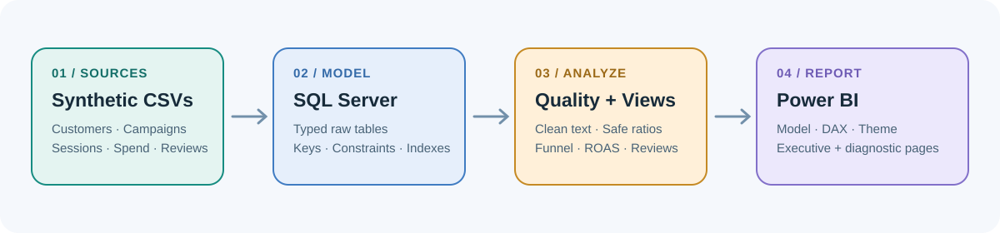

# Marketing Performance Analytics

**SQL Server · Power BI · Marketing measurement · Customer journey analysis**


A self-contained portfolio case study for exploring acquisition efficiency, campaign return, funnel progression, content engagement, product performance, and customer feedback. The repository includes synthetic CSVs, SQL Server table definitions and load scripts, analytical views, query examples, Power BI DAX measures, and documentation.

> **Data note:** every row in the included datasets is synthetic and created for this portfolio exercise. Names, emails, campaigns, ratings, costs, and outcomes do not represent real customers or a real business. Do not present the example results as company performance.

## The business problem

A marketing lead needs one consistent view of spend and attributed revenue, but campaign metrics, site sessions, product interactions, and customer reviews are held in separate files. This project creates a small reporting layer so a stakeholder can answer:

- Which channels and campaigns deliver the strongest attributed return?
- Where are potential customers dropping out of the journey?
- Which products generate the most revenue and how do customers rate them?
- Does content engagement vary by campaign and content format?
- What data-quality issues need attention before the dashboard is trusted?

## What is included

| Area | Deliverable | Purpose |
|---|---|---|
| Data | 7 raw CSV files + 1 processed example | Reproducible, synthetic source data |
| SQL Server | Schema, CSV load script, checks, views, analysis queries | Data ingestion, cleanup, reusable metrics |
| Power BI | DAX measures, theme JSON, model plan, page specification | Dashboard build guide |
| Documentation | Data dictionary, analysis brief, runbook, attribution note | Explain decisions and reproduce the work |

## Project flow

```text
Synthetic CSVs
    ↓
SQL Server raw schema
    ↓
Data-quality checks + cleaned views
    ↓
Campaign, funnel, product, content and review metrics
    ↓
Power BI semantic model + report pages
```



## Quick start

1. Use SQL Server 2019+ and SQL Server Management Studio (SSMS), or an equivalent SQL client.
2. Run `sql/00_setup/01_create_schema_and_tables.sql`.
3. Open `sql/00_setup/02_load_csv_files.sql`, update the absolute data-folder path, and execute the inserts. Alternatively, import the seven files in `data/raw/` with SSMS's flat-file import, mapping to the table definitions in the setup script.
4. Run `sql/01_quality/01_data_quality_checks.sql`. Investigate any non-zero exception counts before reporting.
5. Run `sql/02_transform/02_create_analytics_views.sql`.
6. Run `node scripts/validate-data.mjs` to validate CSV row counts and keys locally.
7. Run selected queries from `sql/03_analytics/`.
8. In Power BI Desktop, import the source CSVs or connect to the SQL views. Follow `powerbi/README.md`, import `powerbi/marketing_theme.json`, and add measures from `powerbi/measures.dax`.

Detailed setup and caveats: [`docs/reproduction_checklist.md`](docs/reproduction_checklist.md).

## Data at a glance

| File | Rows (header excluded) | Grain |
|---|---:|---|
| `customers.csv` | 160 | One row per customer |
| `products.csv` | 12 | One row per product |
| `campaigns.csv` | 8 | One row per campaign |
| `customer_journey.csv` | 1,800 | One row per session / highest stage reached |
| `campaign_spend_daily.csv` | 2,040 | One row per active campaign per date |
| `content_engagement.csv` | 950 | One row per content engagement record |
| `customer_reviews.csv` | 520 | One row per review |
| `customer_reviews_clean_sample.csv` | 520 | Cleaned review-text example |

The primary observation window is **January 1–December 31, 2025**. Some customer signup dates predate the analysis window to allow repeat-customer analysis.

## Metric definitions

- **Spend**: sum of campaign daily spend.
- **Attributed revenue**: revenue provided in the synthetic campaign-performance file; it is an attribution input, not audited revenue.
- **ROAS**: attributed revenue divided by spend.
- **CTR**: clicks divided by impressions.
- **Click-to-conversion rate**: attributed conversions divided by clicks.
- **Cost per attributed conversion**: spend divided by attributed conversions.
- **Journey purchase rate**: sessions whose highest recorded journey stage is `Purchase`, divided by sessions in the journey table. This is a simplified synthetic funnel, not a multi-touch attribution model.
- **Average review rating**: arithmetic mean of submitted star ratings; it should be considered with review count and rating distribution.

Do not add journey-table orders to campaign-attributed revenue and then call the result total revenue: the sources describe different measurement views and may overlap.

## Data model

- `raw.customers` → customer dimension
- `raw.products` → product dimension
- `raw.campaigns` → campaign dimension
- `raw.customer_journey` → session and funnel fact
- `raw.campaign_spend_daily` → campaign measurement fact
- `raw.content_engagement` → content engagement fact
- `raw.customer_reviews` → customer feedback fact

The Power BI model and recommended relationships are documented in `powerbi/model_and_report_plan.md`. Keep campaign performance and journey outcomes as separate facts to avoid multiplying spend when joining it to session-level rows.

## Limitations worth stating in an interview

1. Data is synthetic, so the analysis demonstrates method rather than a real commercial result.
2. The attributed-revenue values are supplied by the source data and should not be interpreted as incrementality.
3. The journey file records one final stage per session rather than every event in a session.
4. Spend, attributed conversions, and journey purchases are distinct measurement facts; reconciliation is a next step.
5. No personal data, API keys, credentials, or live ad-platform connections are required.

## Repository map

```text
marketing-performance-analytics/
├── README.md
├── data/
│   ├── README.md
│   ├── raw/                    # Seven synthetic CSV source files
│   └── processed/              # Cleaned review sample + notes
├── sql/
│   ├── 00_setup/               # Schema, tables, CSV load
│   ├── 01_quality/             # Data-quality checks
│   ├── 02_transform/           # Reusable analytical views
│   ├── 03_analytics/           # Business questions and cohort queries
│   ├── 04_validation/          # Sanity checks
│   └── README.md
├── powerbi/                    # DAX, model plan, theme and report spec
├── docs/                       # Data dictionary, brief, runbook, attribution
├── scripts/                    # Dependency-free Node.js CSV validator
├── .github/workflows/          # Automated data validation
└── assets/                     # Editable SVG cover + data-flow graphic
```

## Project ownership and attribution

This repository is a distinct rebuild with newly authored SQL, documentation, report specifications, and newly generated synthetic data. The public marketing-analytics portfolio repository that motivated the topic is credited in [`docs/attribution.md`](docs/attribution.md); its original data and code are not bundled here. Before publishing, replace the portfolio-author placeholder in that document with your name and only describe work you have personally reviewed and can explain.

## Suggested portfolio description

> Built a SQL Server and Power BI marketing analytics case study using synthetic campaign, customer journey, content, product, and review data. Designed relational tables, wrote data-quality checks and reusable analytical views, defined channel-performance measures (ROAS, CTR, and cost per conversion), and documented a dashboard model that separates campaign measurement from session-level behavior.

## Reproducible example metrics

[`docs/synthetic_results_snapshot.md`](docs/synthetic_results_snapshot.md) lists calculated totals from the included synthetic CSV files and provides a compact output to compare with the SQL queries. Those figures are demonstration data, not evidence about a real business.

## Automated CSV validation

The repository includes `scripts/validate-data.mjs`, a dependency-free Node.js validator for row counts, keys, foreign-key-like joins, domain values, and numeric ranges. Run it with `node scripts/validate-data.mjs`; GitHub Actions runs the same checks on pushes and pull requests. It does not require a Python runtime or any third-party package.
